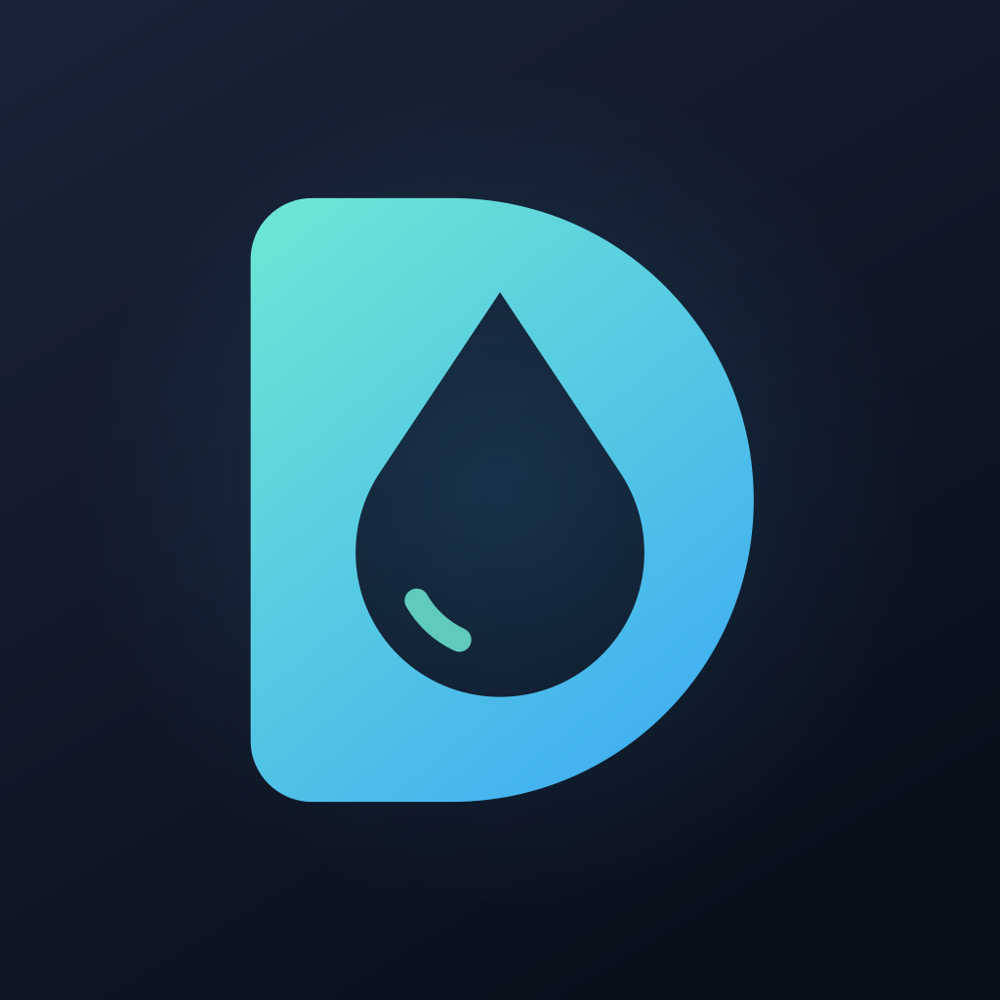
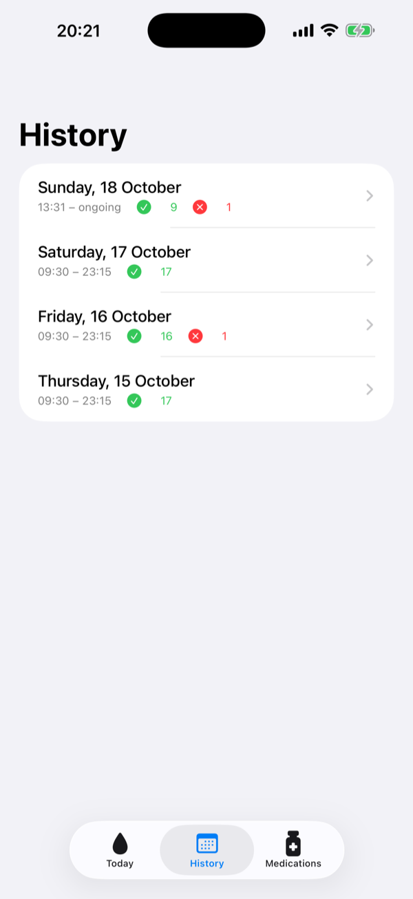
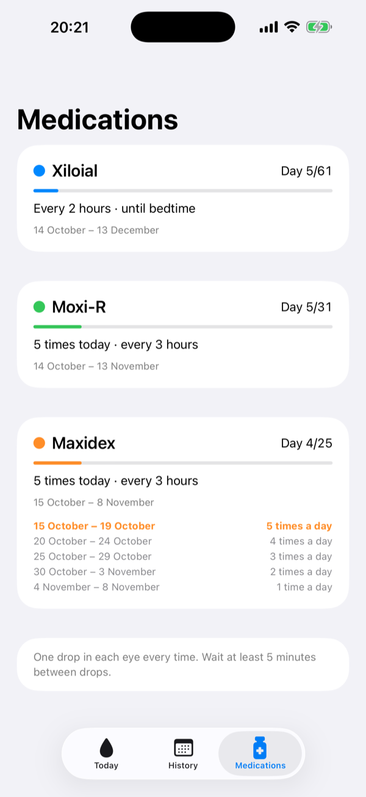
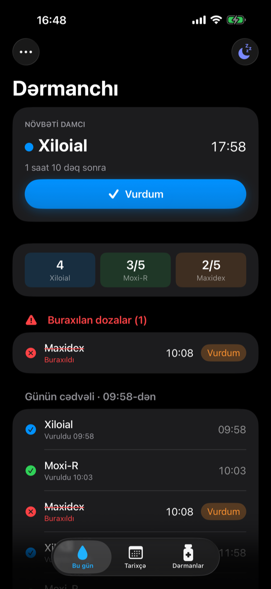
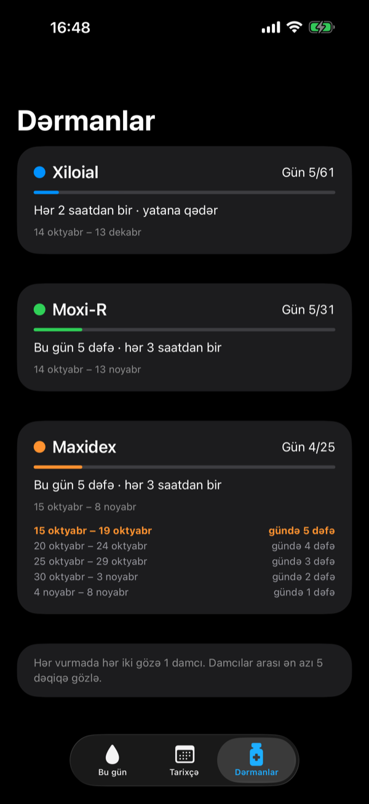
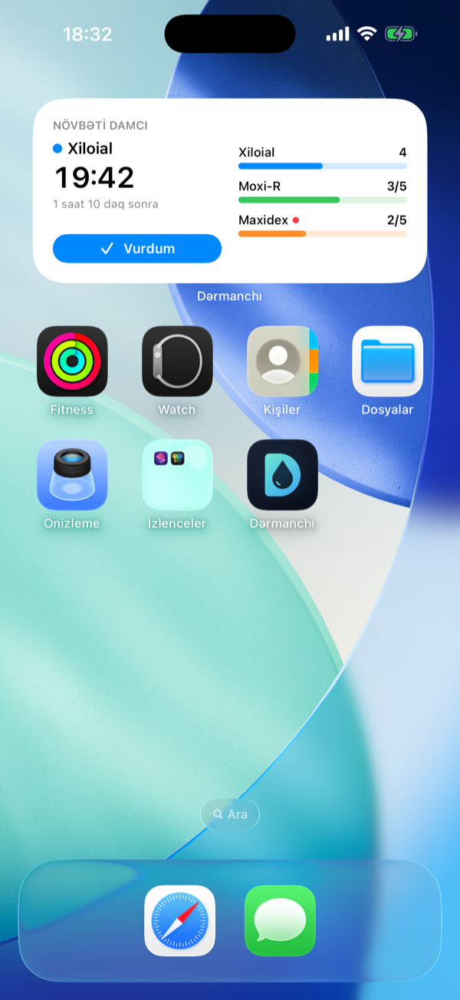
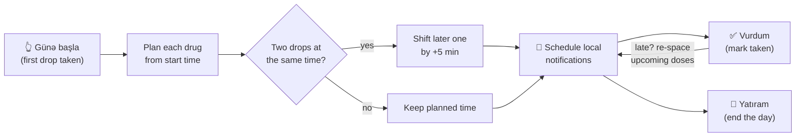

<div align="center">



# Dərmanchı

**A calm, private iOS companion for complicated eye-drop schedules after surgery.**

Tap once when you take your first drop. Dərmanchı builds the rest of the day for you.


[Features](#-features) · [Widgets](#-widgets) · [How it works](#-how-the-schedule-works) · [Getting started](#-getting-started) · [Roadmap](#-roadmap)

</div>

<br />

<div align="center">

| Today | History | Medications |
| :---: | :---: | :---: |
|  |  |  |

</div>

> [!NOTE]
> Dərmanchı is a personal project I built for my own recovery after eye surgery. It is **not a medical device** and does not give medical advice. Always follow your doctor's instructions. The UI is in Azerbaijani 🇦🇿.

## 💡 Why

After surgery I came home with three different eye drops, each on its own rhythm:

| Drop | Frequency | Duration |
| --- | --- | --- |
| 🔵 **Xiloial** | every 2 hours, until bedtime | 2 months |
| 🟢 **Moxi-R** | 5× a day, every 3 hours | 1 month |
| 🟠 **Maxidex** | every 3 hours, tapering 5 → 4 → 3 → 2 → 1 per day, 5 days per step | 25 days |

On top of that, two drops should never go in back-to-back: you wait about **5 minutes** between them. Generic reminder apps can't express "every 2 hours *starting from whenever I woke up*" or "one fewer dose every five days", so I built one that can.

## ✨ Features

- 🌅 **One-tap day start**: take your first drop, tap *Günə başla*, and the whole day's timeline is generated from that moment.
- ⏱️ **Automatic 5-minute spacing**: when two drops fall at the same time, the second one is pushed back by 5 minutes. If you're late, everything after shifts to keep the gap.
- 📉 **Tapering built in**: Maxidex drops from 5 to 1 dose a day on its own, and each drug stops on its end date.
- 🔔 **Local notifications** for every dose, including a "next up" hint ("Sonra: Moxi-R in 5 min").
- 👆 **Act right from the notification**: long-press, or swipe on the Lock Screen, then tap **Vurdum** to log the drop or **10 dəq sonra xatırlat** to snooze. You never have to open the app. Snoozing shifts the whole cluster of drops due at that time and keeps the 5-minute gaps.
- 🧩 **Home and Lock Screen widgets** show the next drop with a live countdown and today's progress. The home-screen widgets have a **Vurdum** button that logs the drop without opening the app.
- 🚨 **Missed-dose tracking**: anything more than an hour late is flagged in red and stays visible so you can still log it.
- 🌙 **"Going to sleep" button**: ends the day and silences remaining reminders. Forgot to press it? The next morning closes the previous day for you.
- 🕙 **Backfill**: started your drops before opening the app? Pick the real start time and past doses are logged at their scheduled times.
- 🗓️ **History** of every day, with taken and missed counts.
- 🔒 **100% on-device**: no account, no server, no analytics.

<details>
<summary><b>🌗 Dark mode</b></summary>
<br />
<div align="center">

&nbsp;&nbsp;

</div>
</details>

## 🧩 Widgets

<table>
<tr>
<td width="300" valign="top">

</td>
<td valign="top">

| Widget | Size | Shows |
| --- | --- | --- |
| **Next drop** | Small | Drug, time, countdown and a **Vurdum** button |
| **Day progress** | Medium | Next drop, plus a progress bar for each drug. A red dot marks a missed dose |
| **Lock Screen** | Rectangular | `💧 Xiloial · 18:00`, the time left, and the drop after it |

- The countdown text ("52 dəq sonra") is pre-computed into minute-by-minute timeline entries, so it stays accurate without waking the app.
- **Vurdum** runs an App Intent in the app's process. The app re-spaces the next drops, rebuilds notifications, and reloads every widget.
- Once a drop is due, the widget turns red and shows *İNDİ VUR* ("take it now") along with how late it is.

</td>
</tr>
</table>

> [!NOTE]
> The app and the widget share one SwiftData store inside an **App Group**. App Groups work with a free Apple ID personal team; this was verified by signing a test project. On first launch, data from earlier versions is migrated into the group automatically. The old file is copied, never moved.

## 🧠 How the schedule works



Each dose keeps two timestamps:

- **`plannedAt`** is the ideal time from the drug's rhythm and never changes.
- **`scheduledAt`** is when you're actually reminded, after spacing is applied.

Spacing is always recomputed from `plannedAt`, so a single late drop never makes the whole day drift.

<details>
<summary><b>Example: a day that starts at 10:00</b></summary>

| Time | Drop |
| --- | --- |
| 10:00 | Xiloial |
| 10:05 | Moxi-R |
| 10:10 | Maxidex |
| 12:00 | Xiloial |
| 13:00 | Moxi-R |
| 13:05 | Maxidex |
| 14:00 | Xiloial |
| 16:00 | Xiloial |
| 16:05 | Moxi-R |
| 16:10 | Maxidex |
| 18:00 | Xiloial |
| … | … |

</details>

## 🛠 Tech stack

| | |
| --- | --- |
| **UI** | SwiftUI with iOS 26 Liquid Glass tab bar and toolbars |
| **Persistence** | SwiftData (`DaySession` and `Dose` models) |
| **Reminders** | `UserNotifications` calendar triggers with *Vurdum* and snooze actions, rebuilt on every change |
| **Widgets** | WidgetKit (small, medium, Lock Screen rectangular) with an interactive App Intent button |
| **Sharing** | App Group container for the SwiftData store |
| **Project** | [XcodeGen](https://github.com/yonaskolb/XcodeGen) (`project.yml` is the source of truth) |
| **Tests** | XCTest for scheduling, tapering and backfill logic |
| **Backend** | None |

```
Dermanchi/
├── App/            # App entry, tab bar
├── Model/          # Medication definitions, SwiftData models
├── Logic/          # DoseScheduler, DayActions, notifications, widget state, App Intent
└── Views/          # Today, Start-day sheet, History, Medications
DermanchiWidget/    # WidgetKit extension (shares Model/ and Logic/ with the app)
DermanchiTests/     # Scheduler, day-flow, notification-action and widget-state tests
design/logo/        # App icon source (SVG) and social preview
scripts/            # install-iphone.sh
```

## 🚀 Getting started

**Requirements:** macOS with Xcode 26+, [XcodeGen](https://github.com/yonaskolb/XcodeGen) (`brew install xcodegen`), and an iPhone on iOS 26+.

```bash
git clone https://github.com/bahramzada/dermanchi.git
cd dermanchi
xcodegen generate
open Dermanchi.xcodeproj
```

To install on a connected iPhone from the command line:

```bash
./scripts/install-iphone.sh
```

> [!TIP]
> With a free Apple ID, sideloaded apps expire after **7 days**. Re-run the script to refresh. Your data stays on the device.

> [!IMPORTANT]
> Set your own `DEVELOPMENT_TEAM` in `project.yml` before building for a device, and change the bundle IDs and the App Group (`group.com.raullte.dermanchi` in `project.yml` and `AppModel.appGroupID`) to your own. If the project lives in an iCloud-synced folder (Desktop or Documents), keep DerivedData outside it, or code signing fails with *"resource fork, Finder information, or similar detritus not allowed"*. The script already does this.

### Using your own prescription

Drugs are defined in [`Dermanchi/Model/Medication.swift`](Dermanchi/Model/Medication.swift). Three rules cover most regimens:

```swift
.untilSleep                       // every N hours until you tap "Yatıram"
.fixed(5)                         // N times a day
.taper(start: 5, stepDays: 5)     // 5/day, one fewer every 5 days
```

## 🗺 Roadmap

- [x] **Phase 1: Core app.** Day start, auto-schedule, 5-minute spacing, tapering, notifications, missed doses, history, backfill.
- [x] **Phase 2a: Actionable notifications.** *Vurdum* and *Snooze* buttons right on the notification.
- [x] **Phase 2b: Widgets.** Small and medium home-screen widgets with a *Vurdum* button, plus a Lock Screen widget.
- [ ] **Phase 2c: Live Activity.** Countdown to the next drop in the Dynamic Island and on the Lock Screen.
- [ ] **Phase 3: Insights.** Adherence stats, per-drug countdown, PDF report to share with the doctor.

## 🔒 Privacy

Everything stays on your iPhone. Dərmanchı makes no network requests and has no third-party SDKs.

<div align="center">
<br />
<sub>Made with 💧 during recovery.</sub>
</div>
