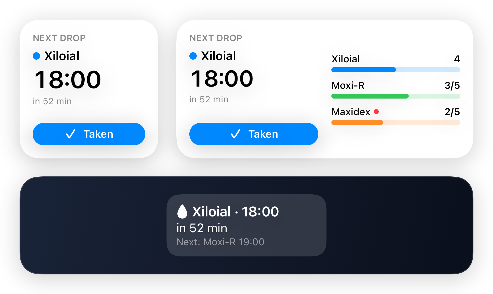
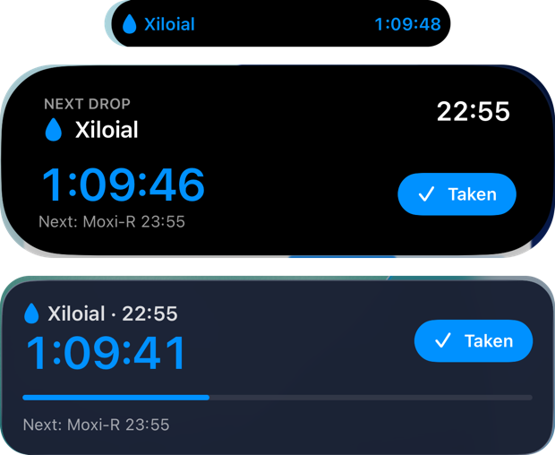
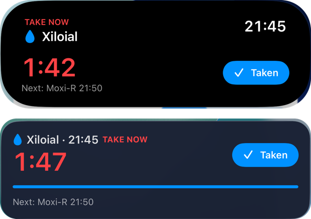
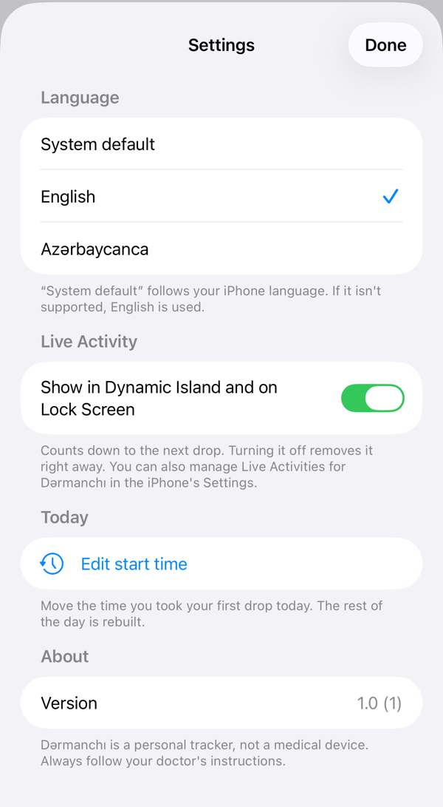
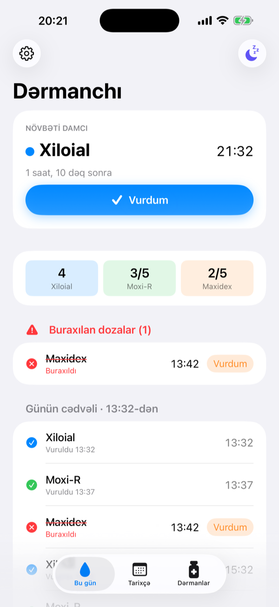
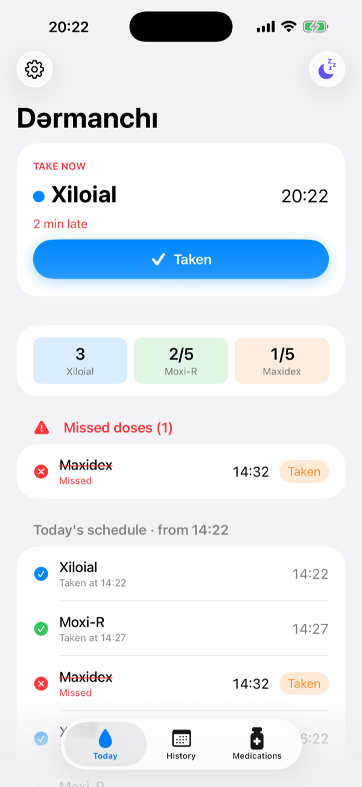
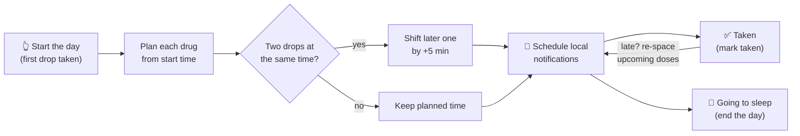

<div align="center">


# Dərmanchı

**A calm, private iOS companion for complicated eye-drop schedules after surgery.**

Tap once when you take your first drop. Dərmanchı builds the rest of the day for you.


[Features](#-features) · [Widgets](#-widgets) · [Live Activity](#-live-activity) · [Settings and languages](#%EF%B8%8F-settings-and-languages) · [How it works](#-how-the-schedule-works) · [Getting started](#-getting-started) · [Roadmap](#-roadmap)

</div>

<br />

<div align="center">

| Today | History | Medications |
| :---: | :---: | :---: |
|  |  |  |

</div>

> [!NOTE]
> Dərmanchı is a personal project I built for my own recovery after eye surgery. It is **not a medical device** and does not give medical advice. Always follow your doctor's instructions. The app is available in English and Azerbaijani 🇦🇿 (Settings → Language); see [docs/LOCALIZATION.md](docs/LOCALIZATION.md) for how to add another language.

> [!TIP]
> Button names in this README are the English ones. In Azerbaijani they read *Vurdum* (Taken), *Günə başla* (Start the day) and *Yatıram* (Going to sleep).

## 💡 Why

After surgery I came home with three different eye drops, each on its own rhythm:

| Drop | Frequency | Duration |
| --- | --- | --- |
| 🔵 **Xiloial** | every 2 hours, until bedtime | 2 months |
| 🟢 **Moxi-R** | 5× a day, every 3 hours | 1 month |
| 🟠 **Maxidex** | every 3 hours, tapering 5 → 4 → 3 → 2 → 1 per day, 5 days per step | 25 days |

On top of that, two drops should never go in back-to-back: you wait about **5 minutes** between them. Generic reminder apps can't express "every 2 hours *starting from whenever I woke up*" or "one fewer dose every five days", so I built one that can.

## ✨ Features

- 🌅 **One-tap day start**: take your first drop, tap *Start the day*, and the whole day's timeline is generated from that moment.
- ⏱️ **Automatic 5-minute spacing**: when two drops fall at the same time, the second one is pushed back by 5 minutes. If you're late, everything after shifts to keep the gap.
- 📉 **Tapering built in**: Maxidex drops from 5 to 1 dose a day on its own, and each drug stops on its end date.
- 🔔 **Local notifications** for every dose, including a "next up" hint ("Next: Moxi-R (in 5 min)").
- 👆 **Act right from the notification**: long-press, or swipe on the Lock Screen, then tap **Taken** to log the drop or **Remind in 10 min** to snooze. You never have to open the app. Snoozing shifts the whole cluster of drops due at that time and keeps the 5-minute gaps.
- 🧩 **Home and Lock Screen widgets** show the next drop with a live countdown and today's progress. The home-screen widgets have a **Taken** button that logs the drop without opening the app.
- ⏳ **Live Activity** in the Dynamic Island and on the Lock Screen: a second-by-second countdown to the next drop with a **Taken** button. It turns red when the drop is due, and you can switch it off in Settings.
- 🌍 **English and Azerbaijani**, switchable in Settings. A settings panel also holds *Edit start time*. Adding another language takes a few minutes.
- 🚨 **Missed-dose tracking**: anything more than an hour late is flagged in red and stays visible so you can still log it.
- 🌙 **"Going to sleep" button**: ends the day and silences remaining reminders. Forgot to press it? The next morning closes the previous day for you.
- 🕙 **Backfill**: started your drops before opening the app? Pick the real start time and past doses are logged at their scheduled times.
- 🗓️ **History** of every day, with taken and missed counts.
- 🔒 **100% on-device**: no account, no server, no analytics.

<details>
<summary><b>🌗 Dark mode</b></summary>
<br />
<div align="center">

&nbsp;&nbsp;

</div>
</details>

## 🧩 Widgets

<p align="center">
  
</p>

| Widget | Size | Shows |
| --- | --- | --- |
| **Next drop** | Small | Drug, time, countdown and a **Taken** button |
| **Day progress** | Medium | Next drop, plus a progress bar for each drug. A red dot marks a missed dose |
| **Lock Screen** | Rectangular | `💧 Xiloial · 18:00`, the time left, and the drop after it |

- The countdown text ("in 52 min") is pre-computed into minute-by-minute timeline entries, so it stays accurate without waking the app.
- **Taken** runs an App Intent in the app's process. The app re-spaces the next drops, rebuilds notifications, and reloads every widget.
- Once a drop is due, the widget turns red and shows *TAKE NOW* ("take it now") along with how late it is.
- These images are rendered from the real widget views by `WidgetSnapshotTests`. Run them with `TEST_RUNNER_SNAPSHOT_DIR=$PWD/docs/screenshots` to regenerate.

> [!NOTE]
> The app and the widget share one SwiftData store inside an **App Group**. App Groups work with a free Apple ID personal team; this was verified by signing a test project. On first launch, data from earlier versions is migrated into the group automatically. The old file is copied, never moved.

## ⏳ Live Activity

<p align="center">
  
</p>

<p align="center">
  
  <br />
  <sub>Once the drop is due: <i>TAKE NOW</i> in red, and the timer counts up how late it is.</sub>
</p>

- **Switch it off:** *Settings → Live Activity*. Turning it off removes the activity immediately, and turning it on brings it back.
- **Compact island:** the drug name in its color, plus a live countdown.
- **Expanded island:** the drug, its time, a large countdown, the drop after it, and **Taken**.
- **Lock Screen:** the countdown, a progress bar filling from the last drop to the next, and **Taken**.
- **Lifecycle:** the activity starts with *Start the day* and moves to the next drop after every *Taken*, whether from the app, a notification, a widget, or the island. It ends with *Going to sleep*.
- When a drop is due, the activity's `staleDate` passes. iOS turns it red with *TAKE NOW* and the timer starts counting up how late you are. The app doesn't need to run for this.
- iOS keeps a Live Activity for about 8 hours. The app replaces it before 7 hours, so a long day keeps its countdown.

These are real simulator screenshots, and the Live Activity was also tested on an iPhone 14 Pro Max. The timers count down live, so the captures were taken a few seconds or minutes apart.

## ⚙️ Settings and languages

<p align="center">
  
</p>

The gear in the top-left corner opens **Settings**:

- **Language:** *System default*, *English* or *Azərbaycanca*. *System default* follows the iPhone's language and falls back to **English** when it isn't supported. The change applies at once to the app, notifications, widgets and the Live Activity.
- **Live Activity:** turn the Dynamic Island and Lock Screen countdown on or off.
- **Edit start time:** fix the time you took your first drop today. The rest of the day is rebuilt.

<p align="center">
  
  &nbsp;&nbsp;
  
  <br />
  <sub>The same screen in Azerbaijani, and in English when a drop is overdue.</sub>
</p>

Every string lives in one String Catalog, and tests fail when a translation is missing, so adding a language is mostly translating one file. See [docs/LOCALIZATION.md](docs/LOCALIZATION.md).

## 🧠 How the schedule works



Each dose keeps two timestamps:

- **`plannedAt`** is the ideal time from the drug's rhythm and never changes.
- **`scheduledAt`** is when you're actually reminded, after spacing is applied.

Spacing is always recomputed from `plannedAt`, so a single late drop never makes the whole day drift.

<details>
<summary><b>Example: a day that starts at 10:00</b></summary>

| Time | Drop |
| --- | --- |
| 10:00 | Xiloial |
| 10:05 | Moxi-R |
| 10:10 | Maxidex |
| 12:00 | Xiloial |
| 13:00 | Moxi-R |
| 13:05 | Maxidex |
| 14:00 | Xiloial |
| 16:00 | Xiloial |
| 16:05 | Moxi-R |
| 16:10 | Maxidex |
| 18:00 | Xiloial |
| … | … |

</details>

## 🛠 Tech stack

| | |
| --- | --- |
| **UI** | SwiftUI with iOS 26 Liquid Glass tab bar and toolbars |
| **Persistence** | SwiftData (`DaySession` and `Dose` models) |
| **Reminders** | `UserNotifications` calendar triggers with *Taken* and snooze actions, rebuilt on every change |
| **Widgets** | WidgetKit (small, medium, Lock Screen rectangular) with an interactive App Intent button |
| **Languages** | One String Catalog (`Localizable.xcstrings`), a language setting stored in the App Group, system formatters for dates and durations |
| **Live Activity** | ActivityKit with the Dynamic Island and Lock Screen. Updates are local, with no push server |
| **Sharing** | App Group container for the SwiftData store |
| **Project** | [XcodeGen](https://github.com/yonaskolb/XcodeGen) (`project.yml` is the source of truth) |
| **Tests** | XCTest for scheduling, tapering and backfill logic |
| **Backend** | None |

```
Dermanchi/
├── App/            # App entry, tab bar
├── Model/          # Medication definitions, SwiftData models
├── Logic/          # DoseScheduler, DayActions, notifications, widget state, App Intent
├── Views/          # Today, Start-day sheet, History, Medications, Settings
├── Resources/      # Localizable.xcstrings (English and Azerbaijani)
└── Widgets/        # Widget views (shared by the extension and snapshot tests)
DermanchiWidget/    # WidgetKit extension (shares Model/ and Logic/ with the app)
DermanchiTests/     # Scheduler, day-flow, notification-action, widget-state and snapshot tests
design/logo/        # App icon source (SVG) and social preview
scripts/            # install-iphone.sh
```

## 🚀 Getting started

**Requirements:** macOS with Xcode 26+, [XcodeGen](https://github.com/yonaskolb/XcodeGen) (`brew install xcodegen`), and an iPhone on iOS 26+.

```bash
git clone https://github.com/bahramzada/dermanchi.git
cd dermanchi
xcodegen generate
open Dermanchi.xcodeproj
```

To install on a connected iPhone from the command line:

```bash
./scripts/install-iphone.sh
```

> [!TIP]
> With a free Apple ID, sideloaded apps expire after **7 days**. Re-run the script to refresh. Your data stays on the device.

> [!IMPORTANT]
> Set your own `DEVELOPMENT_TEAM` in `project.yml` before building for a device, and change the bundle IDs and the App Group (`group.com.raullte.dermanchi` in `project.yml` and `AppModel.appGroupID`) to your own. If the project lives in an iCloud-synced folder (Desktop or Documents), keep DerivedData outside it, or code signing fails with *"resource fork, Finder information, or similar detritus not allowed"*. The script already does this.

### Using your own prescription

Drugs are defined in [`Dermanchi/Model/Medication.swift`](Dermanchi/Model/Medication.swift). Three rules cover most regimens:

```swift
.untilSleep                       // every N hours until you tap "Going to sleep"
.fixed(5)                         // N times a day
.taper(start: 5, stepDays: 5)     // 5/day, one fewer every 5 days
```

## 🗺 Roadmap

- [x] **Phase 1: Core app.** Day start, auto-schedule, 5-minute spacing, tapering, notifications, missed doses, history, backfill.
- [x] **Phase 2a: Actionable notifications.** *Taken* and *Snooze* buttons right on the notification.
- [x] **Phase 2b: Widgets.** Small and medium home-screen widgets with a *Taken* button, plus a Lock Screen widget.
- [x] **Phase 2c: Live Activity.** Countdown to the next drop in the Dynamic Island and on the Lock Screen.
- [x] **English and Azerbaijani** with a settings panel and a Live Activity switch.
- [ ] **Phase 3: Insights.** Adherence stats, per-drug countdown, PDF report to share with the doctor.

## 🔒 Privacy

Everything stays on your iPhone. Dərmanchı makes no network requests and has no third-party SDKs.

<div align="center">
<br />
<sub>Made with 💧 during recovery.</sub>
</div>
